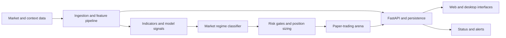

<div align="center">
  
  <h1>Agent Alpha</h1>
  <p><strong>Market research, risk decisions, and paper trading in one system.</strong></p>
  <p><a href="#system-gallery">See the interface</a> · <a href="#architecture">Explore the architecture</a> · <a href="#run-locally">Run locally</a></p>
</div>

Agent Alpha is a quantitative research project for Indian equities. It brings market-data ingestion, technical and machine-learning signals, market-regime analysis, risk gates, backtesting, and simulated execution into a connected workflow. The interface makes each stage inspectable: what the system saw, what it concluded, what risk checks applied, and what happened in the paper-trading arena.

> **Status:** Research and paper-trading software. The public repository does not establish live brokerage execution or independently verified investment returns. Screenshots show the software interface, not evidence of profitability.

## What the system does

| Stage | Purpose |
| --- | --- |
| Market data | Collect and normalize price, volume, and contextual data used by the research pipeline |
| Signal research | Combine technical indicators, model outputs, and statistical research into directional assessments |
| Regime and risk | Classify market conditions, apply veto rules, and size simulated positions |
| Evaluation | Compare signals with historical outcomes and inspect results by regime and strategy |
| Paper trading | Track simulated orders, positions, and portfolio outcomes without placing a real trade |
| Operations | Expose dashboards, scheduled jobs, alerts, and remote status controls |

The project includes a FastAPI backend, persistent data services, a web dashboard, an Electron desktop wrapper, a macOS menu-bar utility, and a separate Sentinel process for scheduled work. Language-model analysis is one input to the research workflow; trade decisions still pass through explicit code-level checks.

## Architecture



The [architecture diagram](.github/assets/diagrams/architecture.png), [ensemble diagram](.github/assets/diagrams/ensemble.png), and [risk-gate diagram](.github/assets/diagrams/veto.png) show more of the implementation. Code lives primarily under `backend/`, `sentinel/`, and `frontend/`.

## Research method

The repository documents several model families rather than a single indicator. Features cover trend, momentum, volatility, flows, and pairs research. A four-state Hidden Markov Model adds market context. A separate veto layer can reject an otherwise positive signal; volatility and Kelly-based calculations inform simulated sizing. The arena and backtests provide a place to examine those decisions over time.

These methods are research tools. Model count, historical backtests, and dashboard screenshots do not establish predictive performance in future markets. Any reported result should be tied to a dated dataset, a stated evaluation window, transaction costs, and a reproducible run.

## Run locally

The project has multiple services and external data dependencies. Start by reviewing [`docker-compose.yml`](docker-compose.yml), [`.env.example`](.env.example), and the configuration modules under `backend/config/`.

```bash
git clone https://github.com/SaiSiddharthBS/Agent_Alpha.git
cd Agent_Alpha
cp .env.example .env
# Fill in only the credentials needed for the components you will run.
docker compose up --build
```

Keep `.env` local. Do not commit API keys, bot tokens, or database passwords. The example file is a template; service availability and data-provider access vary by environment. The dashboard and paper-trading paths may require seeded data or locally configured services before they are useful.

## Repository map

```text
backend/             API, research pipeline, arena, scheduling, and tests
sentinel/            Separate feed and status process
frontend/            Web dashboard and Electron wrapper
Screenshots/           Captures of the main interface and research views
.github/assets/       Architecture and model diagrams
docker-compose.yml    Local service topology
.env.example          Configuration template without live credentials
```

## System Gallery

| Dashboard | Paper-trading arena |
| --- | --- |
|  |  |

| Research view | Signal evaluation |
| --- | --- |
|  |  |

For more captures, browse [`Screenshots/`](Screenshots/). The project is released under the [MIT license](LICENSE).

Built by [Sai Siddharth B S](https://github.com/SaiSiddharthBS).
